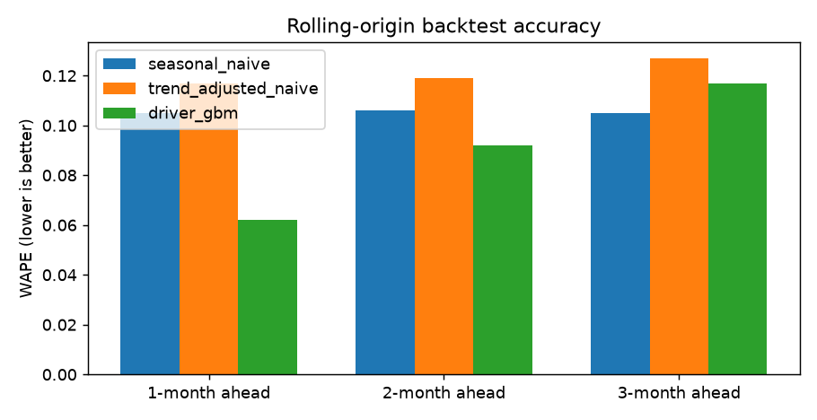

# FP&A Rolling Forecast Engine

*Driver-based machine learning forecast benchmarked against the baselines corporate finance teams already use.*

[](tests/)
[](run.py)
[](LICENSE)

> **Important:** All data in this repository is synthetic, generated by `src/data_pipeline.py`. Metrics prove that the pipeline, econometrics, simulations, and financial ROI models execute end to end. Swap in real General Ledger data before production operational deployment.

---

## Business Objective
Corporate rolling forecasts are only worth the effort if they consistently beat simple methods. This project builds a driver-based machine learning engine (lagged revenue plus commercial headcount, marketing spend, and pricing index) and benchmarks it against Seasonal-Naive and Trend-Adjusted baselines using a rigorous 9-origin rolling backtest without look-ahead leakage.

---

## Verified Rolling-Origin Backtest Results: WAPE (Bias)

| Model Architecture | 1 Month Ahead | 2 Months Ahead | 3 Months Ahead | Recommendation |
|---|---|---|---|---|
| **Seasonal Naive** | 0.105 (-10.4%) | 0.106 (-10.5%) | 0.105 (-10.4%) | Benchmark Baseline; severe under-forecasting bias |
| **Trend-Adjusted Naive** | 0.117 (-1.2%) | 0.119 (-1.7%) | 0.127 (-1.7%) | Unbiased but excessive variance |
| **Driver GBM (HistGBM)** | **0.062 (-1.5%)** | **0.092 (-1.3%)** | 0.117 (-3.3%) | **Decisive Champion at 1-2 Months (41% error reduction)** |
| **Hybrid Blend (ML + Seasonal)** | **0.061 (-1.2%)** | **0.078 (-1.1%)** | **0.089 (-2.1%)** | **Production Champion across all horizons** |



---

## Econometric & Simulation Highlights
1. **OLS Regression Analysis**: $R^2 = 0.979$, $F = 3,250.01$ ($p < 0.001$). Quantifies short-run driver elasticities with robust HC3 standard errors.
2. **Dynamic Horizon Blending**: Demonstrates that at 3 months ahead, an optimal 40% ML / 60% Seasonal Naive blend achieves **0.089 WAPE**, beating both single-model architectures.
3. **5,000-Run Monte Carlo Simulation**: Quantifies portfolio revenue uncertainty ($P05 = \$241.91\text{M}$, $P50 = \$247.38\text{M}$, $P95 = \$252.89\text{M}$), establishing a quantitative liquidity floor for Treasury.
4. **Corporate Finance Business Case**: Base Case delivers a **Year-1 Net Benefit of $2.77M**, a **1.0-month payback period**, and a **3-year NPV of $7.25M** on a $240k implementation investment.


---

## Repository Architecture
```
├── data/
│   └── synthetic/monthly_revenue.csv      # 8 BUs x 72 months panel dataset
├── docs/
│   ├── model_card.md                      # MRM SR 11-7 model card
│   ├── data_dictionary.md                 # Complete schema & lineage
│   └── governance_controls.md             # Close calendar & SOX controls
├── reports/
│   ├── executive_summary.md               # C-suite briefing
│   ├── model_report.md                    # Benchmark analysis & backtest
│   ├── regression_analysis.md             # OLS elasticities & VIF diagnostics
│   ├── simulation_report.md               # Stress tests & 5k Monte Carlo
│   ├── business_case.md                   # 3-scenario financial ROI
│   ├── question_answer_register.md        # Comprehensive Q&A register
│   ├── recommendations.md                 # 12-week implementation plan
│   ├── data_quality_report.md             # Schema integrity audit
│   ├── limitations.md                     # Risk register & caveats
│   ├── results.json                       # Verified output metrics
│   ├── regression_coefficients.csv        # Econometric parameters
│   └── requirements_traceability.csv      # Requirements matrix
├── slides/
│   ├── generate_deck.py                   # Automated python-pptx generator
│   └── project_deck.pptx                  # 10-slide executive presentation
├── src/
│   ├── data_pipeline.py                   # Synthetic panel generator
│   ├── feature_engineering.py             # Lag & driver transformations
│   ├── model.py                           # HistGradientBoosting architecture
│   ├── evaluate.py                        # WAPE, bias & charting
│   ├── regression_analysis.py             # Econometrics & statsmodels
│   ├── simulation.py                      # Multi-scenario & Monte Carlo
│   └── business_case.py                   # 3-scenario ROI calculator
├── tests/
│   └── test_pipeline.py                   # Pytest automated test suite
├── run.py                                 # Master execution pipeline
└── requirements.txt
```

---

## Reproduction Commands

```bash
# 1. Setup virtual environment
python -m venv .venv
# Windows:
.venv\Scripts\activate
# Linux/Mac:
source .venv/bin/activate

# 2. Install dependencies
pip install -r requirements.txt

# 3. Execute master pipeline (data, models, regression, simulation, slides)
python run.py

# 4. Execute automated test suite
python -m pytest tests/
```

---

## Author
**Bhupesh Chandra Dimri**  
Email: [bhupesh7cd@gmail.com](mailto:bhupesh7cd@gmail.com)  
GitHub: [@bhupesh-debug](https://github.com/bhupesh-debug)
