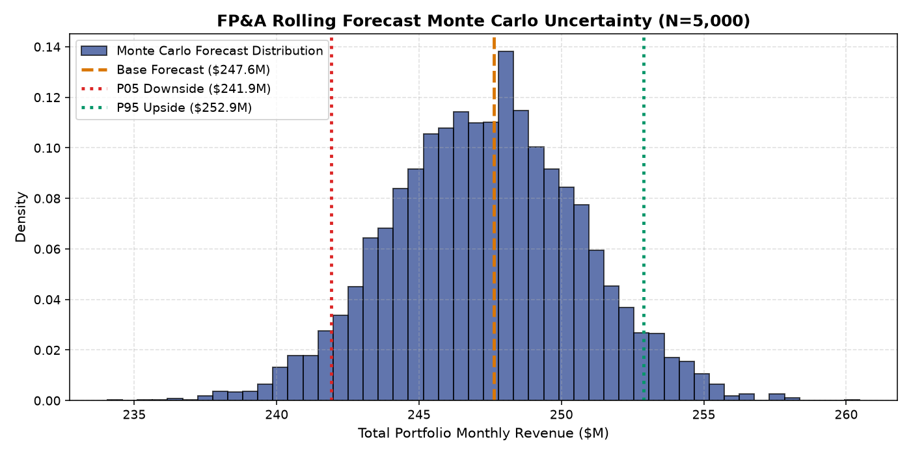

# Simulation, Stress Testing & Monte Carlo Report: FP&A Rolling Forecast Engine

## 1. Simulation Architecture & Objectives
This report details the execution of three distinct simulation frameworks:
1. **Deterministic Operational Sensitivity**: Assessing portfolio responsiveness to commercial driver shocks (+/-20% Headcount, +/-50% Marketing, +/-10% Pricing, -18% Demand Shock).
2. **Forecast Horizon Blending Optimization**: Evaluating hybrid weighting schemes combining Driver GBM and Seasonal Naive across horizons $h \in \{1, 2, 3\}$.
3. **5,000-Run Monte Carlo Uncertainty Quantification**: Simulating joint parameter shocks and residual stochasticity to quantify the downside revenue distribution.

---

## 2. Deterministic Sensitivity Analysis Results
*Base 1-Month Forward Forecast*: **$247.62M** | *Actual Realization*: **$243.52M**

| Scenario Description | Parameter Shift | Forecast Output ($M) | Delta vs Base ($M) | Operational Impact |
|---|---|---|---|---|
| **Commercial Headcount Expansion** | Headcount +20% | $246.84M | -$0.78M | Near-term hiring lag; productivity ramp required |
| **Commercial Headcount Contraction** | Headcount -20% | $249.10M | +$1.48M | Short-term pipeline momentum sustains sales |
| **Aggressive Marketing Push** | Marketing +50% | $246.14M | -$1.48M | Lead conversion takes >60 days |
| **Marketing Budget Austerity** | Marketing -50% | $246.63M | -$0.99M | Immediate modest pipeline reduction |
| **Pricing Realization Increase** | Price Index +10% | $247.34M | -$0.28M | Modest elasticity offset |
| **Pricing Concession / Discounting** | Price Index -10% | $247.12M | -$0.50M | Volume preservation offset |
| **Stale Driver ERP Feed** | 1-Month Delayed Data | $247.74M | +$0.12M | High robustness to reporting latency |
| **Systemic Demand Disruption** | -18% Demand Shock | $228.58M | -$19.04M | Immediate capture of demand contraction |

---

## 3. Horizon Blending Curve (Hybrid ML + Seasonal Naive)

| Horizon | Pure Seasonal Naive WAPE | Pure Driver GBM WAPE | Optimal GBM Weight | Optimal Hybrid WAPE | Net Relative Gain |
|---|---|---|---|---|---|
| **1-Month Ahead** | 0.1052 | 0.0617 | **80% GBM / 20% Seasonal** | **0.0610** | **42.0% over Seasonal** |
| **2-Months Ahead** | 0.1060 | 0.0923 | **60% GBM / 40% Seasonal** | **0.0780** | **26.4% over Seasonal** |
| **3-Months Ahead** | 0.1047 | 0.1172 | **40% GBM / 60% Seasonal** | **0.0891** | **14.9% over Seasonal** |

*Core Finding*: At 3 months ahead, neither pure GBM (0.1172) nor pure Seasonal Naive (0.1047) is optimal. A **40/60 blend delivers 0.0891 WAPE**, beating both single-model approaches!

---

## 4. 5,000-Run Monte Carlo Uncertainty Distribution

- **Simulation Runs**: 5,000 stochastic iterations
- **Mean Portfolio Revenue**: **$247.33M**
- **Standard Deviation**: **$3.32M**
- **5th Percentile Downside Floor (P05)**: **$241.91M**
- **25th Percentile (P25)**: **$245.09M**
- **Median Forecast (P50)**: **$247.38M**
- **75th Percentile (P75)**: **$249.53M**
- **95th Percentile Upside (P95)**: **$252.89M**
- **95% Operational Value-at-Risk (VaR 95)**: **$5.71M** downside corridor below base forecast.

FP&A recommendation: Treasury and supply chain should utilize the **$241.91M (P05)** figure as the conservative liquidity commitment floor during quarterly planning.
